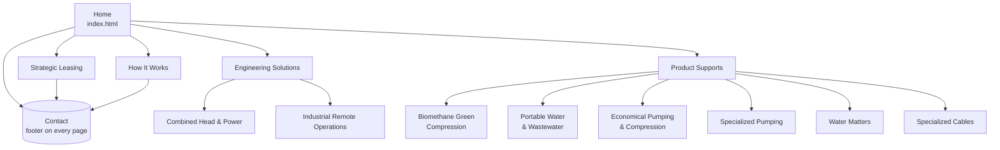

# Rota Ventures — Website Sitemap

Corporate profile site for Rota Ventures. Static, class-driven HTML. One flat nav level with two grouped content areas. Every page funnels to the contact CTA in the footer (`#contact`), which appears on all 11 pages.

- **Canonical domain:** rotaventures.com.my (assumed)
- **Canonical page:** `index.html`
- **Design language:** `design-guidelines/design-system.json` (EcoVolt study recreation)

## Page inventory

| # | Page | File | Nav group | Purpose | Primary CTA |
|---|------|------|-----------|---------|-------------|
| 0 | Home | `index.html` | Home (current-page pill) | Present the business: engineering, leasing, product support; funnel visitors to contact | Contact Us (footer) |
| 1 | How It Works | `how-it-works.html` | Primary | Build trust in the 7-step delivery methodology | Contact Us |
| 2 | Strategic Leasing | `strategic-leasing.html` | Primary | Sell the headline leasing model (zero upfront, tax benefits, fixed payments) | Schedule a Consultation |
| 3 | Combined Head & Power | `combined-head-power.html` | Engineering Solutions | Detail the CHP engineering offer | Contact Our Engineers |
| 4 | Industrial Remote Operations | `industrial-remote-operations.html` | Engineering Solutions | Detail the remote monitoring/retrofit offer | Contact Our Engineers |
| 5 | Biomethane Green Compression | `biomethane-compression.html` | Product Supports | Detail the biogas compression support line | Contact Us |
| 6 | Portable Water & Wastewater | `portable-water.html` | Product Supports | Detail deployable water/wastewater treatment | Contact Us |
| 7 | Economical Pumping & Compression | `economical-pumping.html` | Product Supports | Detail cost-efficient pumping systems | Contact Us |
| 8 | Specialized Pumping | `specialized-pumping.html` | Product Supports | Detail pumping for extreme fluids | Contact Us |
| 9 | Water Matters | `water-matters.html` | Product Supports | Detail water resource management consulting | Contact Us |
| 10 | Specialized Cables | `specialized-cables.html` | Product Supports | Detail heavy-duty cabling solutions | Contact Us |

## Hierarchy

Depth is capped at two. All leaf pages are one click from the nav (via their group) and directly linked from Home's engineering row and product grid.

```
/ (index.html)
├── how-it-works.html
├── strategic-leasing.html
├── Engineering Solutions
│   ├── combined-head-power.html
│   └── industrial-remote-operations.html
└── Product Supports
    ├── biomethane-compression.html
    ├── portable-water.html
    ├── economical-pumping.html
    ├── specialized-pumping.html
    ├── water-matters.html
    └── specialized-cables.html
```



## Navigation model

Per `design-guidelines/design-system.json`, the nav is a narrow centred pill bar: burger + wordmark on one side, then a pill group. The current page renders as a solid ink pill; sibling items are surface chips.

- **Desktop:** `Home · How It Works · Strategic Leasing · Solutions (anchor) · Products (anchor)` + Contact pill. The two dropdown groups from the legacy nav are flattened: group landing happens through Home's engineering row / product grid, which link directly to all eight leaf pages.
- **Mobile:** burger opens a full menu listing every page.
- **Global blocks on every page:** sticky pill nav, dark partners bar + footer (address, email, phone, quick links, contact form) — the footer carries the `#contact` anchor target.

## Shared components

- Footer with contact form (`mailto:` handoff to usaid@rotaventures.com.my)
- Partners bar (partner-1 … partner-6 logos, `assets/img/`)
- Per-page CTA band above the footer on all leaf pages

## Page briefs

One brief per page lives in [`docs/briefs/`](briefs/): `index.md`, `how-it-works.md`, `strategic-leasing.md`, `combined-head-power.md`, `industrial-remote-operations.md`, `biomethane-compression.md`, `portable-water.md`, `economical-pumping.md`, `specialized-pumping.md`, `water-matters.md`, `specialized-cables.md`.
